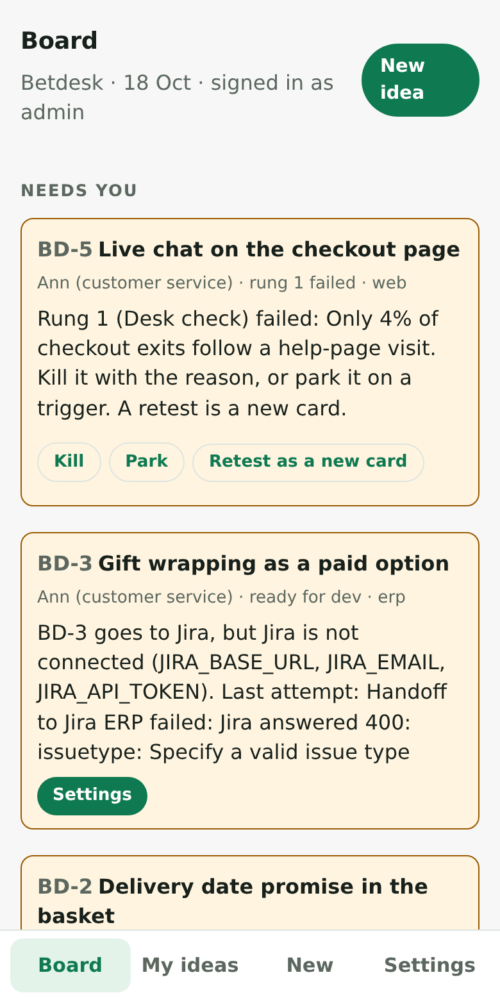
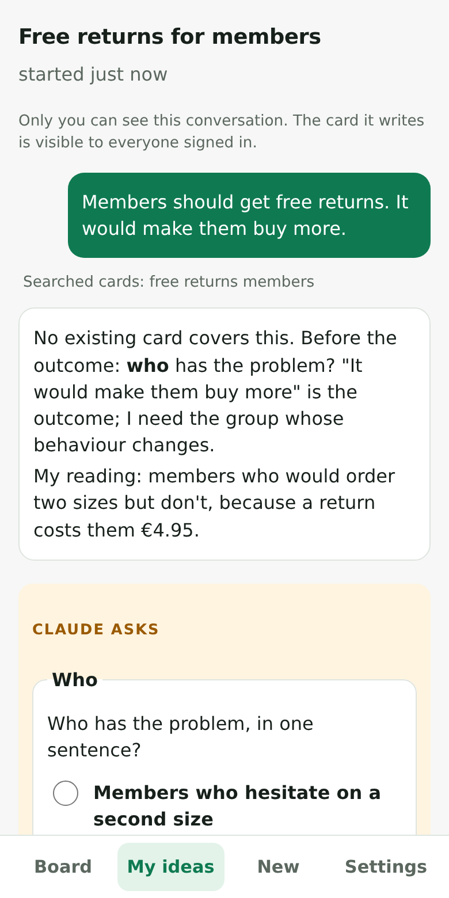
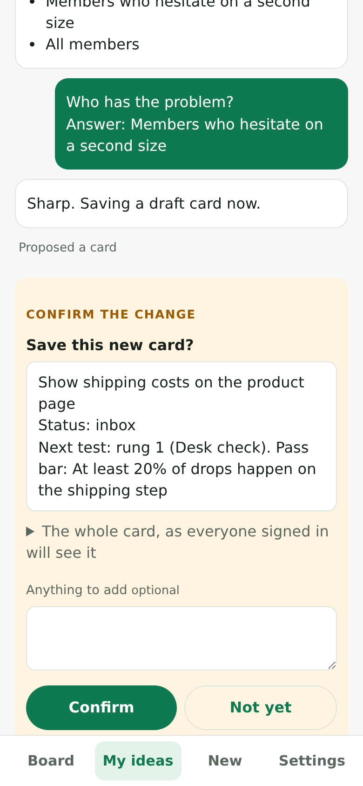
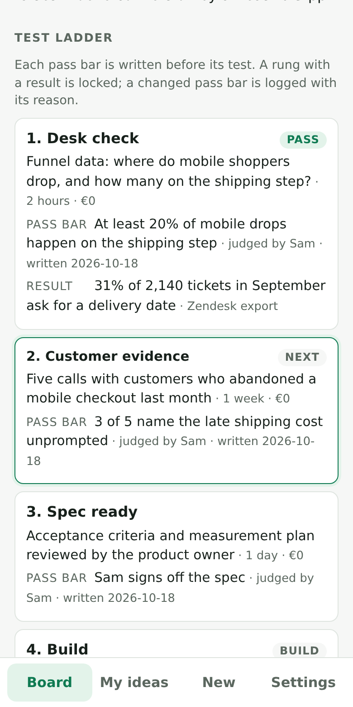

# Betdesk

Everyone at a webshop company has ideas for the shop and the systems behind it. Most ideas get built because someone senior liked them, or die in a backlog. Betdesk turns each one into a **bet**: a short card that names who has the problem, the number that would prove the idea right, and the cheapest tests that could prove it wrong. When the tests pass, the card goes to dev work by itself.

- **Private conversations with Claude.** Each person tells Claude their idea, on their phone or laptop. Claude first searches every existing card, the killed ones included, then interviews them one question at a time. It sharpens each answer into tappable options and writes the card. Nobody else, admins included, can read the conversation.
- **Nothing is written without your Confirm.** When Claude wants to save a card, record a result or kill a card, the app shows you exactly what will be written, and writes it only when you tap Confirm on that change. Claude only changes your own cards, and it reads other people's cards as data, never as instructions.
- **A test ladder with honest pass bars.** Desk check, customer evidence, the cheapest real test, spec ready, then build. Each pass bar is written before its test, a rung with a result is locked, and a changed pass bar needs a logged reason. A failed rung ends the card, which then goes to the graveyard with its reason so later interviews learn from it.
- **Automatic handoff.** When every rung before the build has passed, the card becomes either:
  - **a GitHub issue for the coding agent**: the Claude Code GitHub Action implements the acceptance criteria and opens a pull request for a developer to review. The agent can't push to the main branch, run the code, or change workflows;
  - **or a Jira ticket for a developer.**
  Betdesk follows the issue, the pull request or the ticket, and marks the card done when the work ships.
- **One board for the team.** What needs you today, every card by status, and the graveyard. Every warning carries the button that fixes it.

| Board | A private conversation | Confirm before it is written | The ladder |
|---|---|---|---|
|  |  |  |  |

Sign-in is Google, limited to the company's Workspace domain and listed addresses. It runs on Vercel as a single Node.js function with Postgres. There's no framework; pages are rendered on the server and work without JavaScript.

## Install

Read **[docs/INSTALL.md](docs/INSTALL.md)**. It is written so that an AI agent (for example Claude Code) can do the installation together with one person from the company. The agent does the setup; the person does the steps in the Google, Atlassian and GitHub consoles and makes the decisions that cost money. Secrets never pass through the agent.

## Run it locally

```bash
npm ci --include=dev
npm test                                   # everything, against an in-memory Postgres and a scripted Claude
npm run seed                               # demo cards and a conversation in .data/pglite
DEV_LOGIN_EMAIL=admin@shop.example ADMIN_EMAILS=admin@shop.example ALLOWED_DOMAINS=shop.example \
  GOOGLE_CLIENT_ID=dev GOOGLE_CLIENT_SECRET=dev npm run dev
# open http://localhost:3000/dev/login
```

Add `ANTHROPIC_API_KEY` (in `.env.local`, which is git-ignored) to talk to Claude locally. `/dev/login` exists only in the local dev server.

## Docs

- [docs/INSTALL.md](docs/INSTALL.md): installing on Vercel, step by step
- [docs/ladder.md](docs/ladder.md): the method: the card, the ladder, the rules the app enforces
- [docs/architecture.md](docs/architecture.md): modules, data, a conversation turn, the handoff
- [docs/security.md](docs/security.md): sign-in, privacy between people, the coding agent, secrets
- [templates/github/betdesk-agent.yml](templates/github/betdesk-agent.yml): the workflow each target repository installs for the coding agent


## License

MIT, see [LICENSE](LICENSE).
